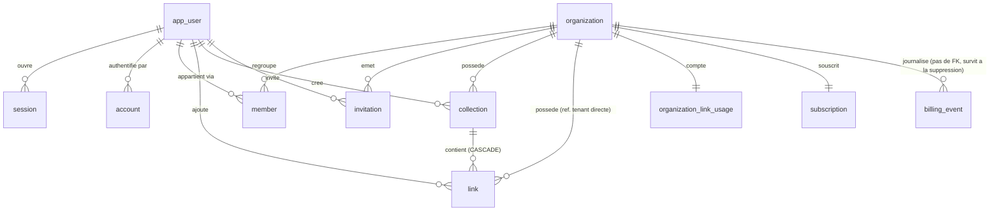

# ERD — Signet

- **Phase** : 2 — architecture
- **Date** : 2026-09-22
- **Mise a jour** : 2026-09-29 — tranche 010 (§1, §2.1, §3, §4, §7, §8.1, matrice, migrations) ; 2026-10-26 — tranche 006 (§0, §1, §2.1, §5, matrice, migrations ; [ADR-0018](ADR/0018-identite-invite-acceptation.md))
- **Socle** : `stack.json` — Postgres, Drizzle, better-auth, Stripe, Inngest
- **Isolation** : `shared-schema-rls` — voir [ADR-0001](ADR/0001-isolation-multitenant.md)
- **Quota Free** : voir [ADR-0002](ADR/0002-quota-free-atomique.md)
- **Token d'invitation** : voir [ADR-0003](ADR/0003-token-invitation-hache.md)
- **Roles Postgres** : voir [ADR-0007](ADR/0007-roles-postgres.md)
- **RLS par appartenance de l'utilisateur de session** : voir [ADR-0011](ADR/0011-rls-appartenance-utilisateur-session.md) (tranche 010, 2026-09-29)

Ce document est la specification de reference du schema. Les migrations Drizzle
(`pnpm db:generate`) couvrent les tables, colonnes, contraintes et index declaratifs ;
les politiques RLS, les triggers et les fonctions `SECURITY DEFINER` sont ecrits a la main
dans des migrations SQL versionnees, dans la meme tranche que la table qu'ils protegent.

---

## 0. Conventions transverses

| Regle | Choix | Raison |
|---|---|---|
| Cle primaire | `uuid` UUIDv7, `DEFAULT uuidv7()` | Ordonne dans le temps (localite d'index) sans exposer de volumetrie ni permettre l'enumeration. Jamais de `serial`. |
| Horodatage | `timestamptz` uniquement | Un `timestamp` sans fuseau est une bombe a retardement ; hebergement UE mais utilisateurs potentiellement ailleurs. |
| Nullabilite | `NOT NULL` par defaut | Chaque colonne nullable de ce document porte une justification d'une ligne. |
| Suppression | Suppression reelle, pas de `deleted_at` | Le PRD n'exige aucune retention (contraintes non fonctionnelles : « aucune politique de retention legale requise »). Un `deleted_at` oublie dans un `WHERE` est une fuite. US-10.3 exige que la collection supprimee « n'apparaisse plus dans aucune consultation » — le `DELETE` reel le garantit sans discipline applicative. |
| Montants | Aucune colonne monetaire dans ce schema | Stripe est la source de verite des montants (US-08, `stack.json`). Si un montant devait etre stocke un jour, ce serait un entier en plus petite unite monetaire (centimes) + code devise ISO-4217, jamais un flottant. |
| Nommage | `snake_case`, tables au singulier | — |
| Texte libre | Toujours borne par un `CHECK char_length(...)` | Une colonne `text` non bornee est un vecteur de saturation trivial. Les bornes retenues sont des valeurs par defaut nommees en §9 (questions ouvertes). |

### Prerequis d'infrastructure

- **Postgres 16** (`stack.json`, decide le 2026-09-22). `uuidv7()` n'est pas une fonction native
  avant Postgres 18 : la migration `0001` **doit** definir `signet.uuidv7()` en PL/pgSQL, et tous
  les `DEFAULT uuidv7()` de ce document pointent en realite vers cette fonction du schema `signet`.
  Ce n'est plus une branche conditionnelle, c'est le chemin unique.
- **better-auth** doit etre configure avec `advanced.database.generateId` produisant un UUIDv7
  (via la meme fonction PL/pgSQL, exposee cote applicatif), sinon les tables qu'il ecrit
  (`app_user`, `session`, `account`, `verification`) recevront des identifiants textuels
  incompatibles avec le type `uuid`.
- **Codes d'erreur applicatifs personnalises.** Au-dela des SQLSTATE standard (`23514` violation
  de `CHECK`, `40001` echec de serialisation), ce schema definit un SQLSTATE de classe utilisateur :
  `SG001` — quota Free depasse a l'ajout d'un lien (§7). La couche d'acces doit le traiter comme
  une erreur metier typee au meme titre que les codes standard, jamais comme un 500.
  `SG002` — identite de session absente ou differente de l'identite demandee, leve par
  `signet.create_organization()` et `signet.organizations_for_user()` (§1, ADR-0011). Ce n'est
  **pas** une erreur metier : elle signale un defaut du serveur (contexte non pose ou incoherent)
  et remonte en 500. Distinct de `42501` pour que le refus d'`EXECUTE` reste reconnaissable.
  `SG003` a `SG006` — refus definitifs de `signet.apply_stripe_subscription()` (§8.1, ADR-0016,
  D-067, D-068) : `SG003` entree `jsonb` invalide ; `SG004` metadonnee d'organisation contraire a
  la ligne deja rattachee ; `SG005` organisation non resolue ; `SG006` incoherence Stripe (autre
  abonnement deja rattache, client different, prix non Pro, identifiant deja rattache ailleurs).
  Aucune ecriture ; la fonction Inngest les journalise sans nouvelle tentative.
  `SG007` — mutation de `billing_event` refusee par le trigger `billing_event_immutable` (§8.2).
  `SG008` — `signet.accept_invitation()` : l'utilisateur de session est deja membre de
  l'organisation de l'invitation (23505 sur `member_org_user_idx`, tranche 006, P-5). Toute
  l'instruction est annulee, invitation comprise. Erreur metier : `409 ALREADY_MEMBER`.
  Exception a la regle « `SG002` remonte en 500 » : sur la route d'acceptation, `SG002` et `23503`
  signalent un compte disparu entre la session et l'appel et sont traduits en `401` (contrat 006).

### Ecarts assumes par rapport aux defauts de better-auth

1. **`user` est renomme `app_user`** (`schema.user.modelName = "app_user"`). `user` est un mot
   reserve SQL : il faudrait le quoter dans chaque migration RLS ecrite a la main. Comme ces
   migrations sont nombreuses et manuelles (ADR-0001), le cout d'un oubli de quote est reel et
   le cout du renommage est d'une ligne de configuration.
2. **La table `invitation` n'est pas celle du plugin organization** : le plugin utilise
   l'identifiant de l'invitation comme secret d'URL, stocke en clair. Voir ADR-0003.
3. Les tables `session`, `account`, `verification` restent telles que better-auth les attend.

---

## 1. Contexte de session et primitives RLS

Le contexte tenant est pose par `SET LOCAL` au debut de chaque transaction, par une connexion
applicative non privilegiee (role `signet_app`, sans `BYPASSRLS`) :

```sql
SET LOCAL app.organization_id = '<uuid de l organisation active>';
SET LOCAL app.user_id         = '<uuid de l utilisateur authentifie>';
```

`app.user_id` est **toujours** pose par le serveur a partir de la session authentifiee
(better-auth), jamais a partir de la requete. `app.organization_id` peut venir de la requete
(parametre d'URL) : c'est pourquoi il n'est jamais utilise brut par les politiques de
`signet_app` (ADR-0011, D-022).

### Primitives de contexte (etat depuis la migration 0009)

Trois fonctions `STABLE` du schema `signet`, sans parametre, servent de base a toutes les
politiques :

| Fonction | Renvoie | Nature | Proprietaire | `EXECUTE` | Utilisee par |
|---|---|---|---|---|---|
| `signet.current_user_id()` | `nullif(current_setting('app.user_id', true), '')::uuid` | `SECURITY INVOKER`, `LANGUAGE sql` (0001, inchangee) | role de migration | `signet_app`, `signet_definer` | politiques des deux roles |
| `signet.context_org()` | `nullif(current_setting('app.organization_id', true), '')::uuid` — **valeur brute** | `SECURITY INVOKER`, `LANGUAGE sql` (0009, nouvelle) | `signet_definer` | **`signet_definer` seul** (proprietaire ; `PUBLIC` revoque, aucun `GRANT`) | politiques de `signet_definer` **uniquement** |
| `signet.current_org()` | `context_org()` **si** une ligne `member (organization_id = context_org(), user_id = current_user_id())` existe, sinon `NULL` — **valeur verifiee** | `SECURITY DEFINER`, `LANGUAGE sql`, `SET search_path = pg_catalog, signet, public, pg_temp`, noms qualifies (`public.member`) (0009, remplace la version brute de 0001) | `signet_definer` | `signet_app` (+ proprietaire) ; `PUBLIC` revoque | politiques de `signet_app` **uniquement** |

Corps attendu de `current_org()` (0009) :

```sql
SELECT m.organization_id
  FROM public.member m
 WHERE m.organization_id = signet.context_org()
   AND m.user_id         = signet.current_user_id();
-- au plus une ligne (member_org_user_idx UNIQUE) ; aucune ligne => NULL
```

**Regles d'usage (invariants, verifies par test de catalogue de la tranche 010)** :
- Une politique `TO signet_app` sur une table tenant s'ecrit `organization_id = signet.current_org()`.
  Elle exige ainsi, sans rien ajouter, que l'utilisateur de session soit membre.
- Une politique `TO signet_definer` n'appelle **jamais** `current_org()` : elle utilise
  `context_org()` (contexte pose par la fonction elle-meme depuis une valeur de confiance) ou
  `current_user_id()`. Appeler `current_org()` y rouvrirait la recursion sur `member` et casserait
  les fonctions qui s'executent sans utilisateur de session.
- Une politique `TO signet_app` n'appelle jamais `context_org()` ; si elle le fait, elle echoue
  (`42501`, pas de droit `EXECUTE`) des la premiere requete.

**Pas de recursion** : la politique `signet_app` de `member` appelle `current_org()`, dont la
requete interne s'execute sous `signet_definer` ; les politiques de `signet_definer` sur `member`
(`member_definer_context`, `member_definer_self_read`) n'appellent pas `current_org()`. La ligne
cherchee (`user_id = current_user_id()`) est visible par `member_definer_self_read`.

**Volatilite `STABLE`** : resultat constant dans une instruction, jamais mis en cache d'une
instruction a l'autre. Un changement d'appartenance fait dans la transaction est vu par
l'instruction suivante de cette transaction. Entre transactions concurrentes, la barriere suit
`READ COMMITTED` : une instruction commencee avant le `COMMIT` d'un retrait s'acheve sur l'ancien
etat. `IMMUTABLE` est interdit (pre-evaluation figee dans un plan prepare reutilise par le pool).

**Cout** : une sonde de `member_org_user_idx` par evaluation ; aucun index supplementaire.

**Fermeture par defaut** : si `app.organization_id` ou `app.user_id` est absent ou vide, ou si
l'utilisateur n'est pas membre, ou s'il n'existe pas, `current_org()` retourne `NULL`, toute
comparaison `organization_id = NULL` est `NULL`, donc fausse. La requete ne retourne rien et
l'ecriture est refusee. Un oubli fait echouer, il ne fait pas fuiter. `current_org()` ne **leve
pas** sur contexte absent : c'est une primitive de politique, pas une operation, et lever
transformerait la fermeture par defaut en erreur.

**Contexte malforme** : une valeur non vide qui n'est pas un UUID fait lever le cast
(`22P02`). Une erreur, jamais une ligne : accepte (ADR-0011 g).

Chaque table portant de la donnee client recoit :

```sql
ALTER TABLE <t> ENABLE ROW LEVEL SECURITY;
ALTER TABLE <t> FORCE  ROW LEVEL SECURITY;  -- le proprietaire est lui aussi soumis
```

`FORCE` est indispensable : sans lui, le role proprietaire (celui qui joue les migrations, et
potentiellement celui d'un script d'exploitation) contourne silencieusement toutes les politiques.

### Points d'entree `SECURITY DEFINER` (liste fermee)

Certaines operations ont lieu *avant* qu'un contexte tenant puisse exister. Elles sont confinees
a quatre fonctions `SECURITY DEFINER` explicitement listees ici. Toute cinquieme fonction de ce
type est un signal de revue d'architecture, pas un detail d'implementation. S'y ajoutent les
fonctions de trigger `SECURITY DEFINER` internes au schema (compteur de quota §7, invariant
owner §4) et, depuis ADR-0011, une primitive de politique (`current_org`) : memes regles, memes
exigences.

| Fonction | Pourquoi elle ne peut pas vivre sous RLS |
|---|---|
| `signet.create_organization(owner_user_id, org_name)` | US-01.1 : a l'inscription, l'organisation n'existe pas encore, il n'y a pas d'`organization_id` a poser. Cree `organization` + `member` (owner) + `organization_link_usage` + `subscription` (free) en une transaction. **Depuis 0009** : leve `SG002` si `app.user_id` est absent ou si `owner_user_id` en differe (on ne cree pas d'organisation au nom d'un tiers). |
| `signet.organizations_for_user(user_id)` | Un utilisateur appartient a plusieurs organisations (PRD §unite de compte). Lister ses organisations est le seul besoin legitime de lecture inter-tenant. **Depuis 0009** : leve `SG002` si `app.user_id` est absent ou si `user_id IS DISTINCT FROM current_user_id()` (avant 0009, un `app.user_id` absent ne levait pas). |
| `signet.lookup_invitation(p_token_hash bytea)` (0015, tranche 006) | L'invite n'est pas encore membre : il n'a aucun contexte tenant. Retourne uniquement `organization_name`, `email` et `state` (`pending`, `expired`, `accepted`) — jamais le contenu de l'organisation, ni identifiant, ni date, ni inviteur. Leve `SG002` sans utilisateur de session (P-4, a rouvrir par 012). Appelee par la route d'acceptation **apres** l'echec de la consommation seulement ; exposee par aucune route. |
| `signet.accept_invitation(p_token_hash bytea)` (0015, tranche 006) | US-03 : consommation atomique du jeton + creation du `member`, hors contexte tenant. Voir §5. **Signature arretee par P-2** : aucun parametre `user_id` ; l'utilisateur est `current_user_id()` (comme `invited_by_user_id` de `create_invitation`), garde `SG002` s'il est absent. `app.organization_id` pose depuis la ligne d'invitation. L'adresse du compte doit etre l'adresse invitee, verifiee dans l'`UPDATE` (P-3, ADR-0018). |
| `signet.apply_stripe_subscription(p_input jsonb)` (0012, tranche 002) | Cinquieme entree, revue d'architecture = **ADR-0016**. Le traitement d'un evenement Stripe n'a pas d'utilisateur de session : il ne peut pas passer par les politiques de `signet_app`. Seul chemin d'ecriture de `subscription` (hors `create_organization`) et de `billing_event`. Executable par `signet_billing` seul. |

### Specification fonction par fonction (liste obligatoire `rules/drizzle-postgres.md`)

Toutes : proprietaire `signet_definer` (`NOLOGIN NOBYPASSRLS`), `REVOKE ALL ... FROM PUBLIC`,
`SET search_path = pg_catalog, signet, public, pg_temp` (`pg_temp` **en dernier** : sinon Postgres
cherche les relations dans le schema temporaire **avant** les autres, et un role disposant de
`TEMPORARY` sur la base pourrait masquer `member` ou `organization` par une table temporaire).
Les fonctions ecrites ou remplacees a partir de 0009 qualifient en plus leurs tables (`public.xxx`).

| Fonction | Premiere instruction (contexte) | Politiques qui la laissent agir | `ROW_COUNT` | `EXECUTE` | Test sans contexte |
|---|---|---|---|---|---|
| `current_org()` (0009) | aucune : lecture seule du couple de session | `member_definer_self_read` | sans objet (lecture) | `signet_app` | renvoie `NULL`, ne leve pas (exception documentee, ADR-0011) |
| `create_organization` (0003, remplacee en 0009) | garde d'identite `SG002`, puis `set_config('app.organization_id', <id genere>, true)` | `organization_definer_context`, `member_definer_context` | `INSERT` seulement (un echec leve) | `signet_app` | `SG002` |
| `organizations_for_user` (0003, remplacee en 0009) | garde d'identite `SG002` ; aucune organisation posee (axe utilisateur) | `organization_definer_self_read`, `member_definer_self_read` | sans objet (lecture) | `signet_app` | `SG002` |
| `create_organization_counters` (trigger, 0005) | aucune : herite du contexte de `create_organization`, seul chemin d'`INSERT INTO organization` | `organization_link_usage_definer_write`, `subscription_definer_insert` | `INSERT` seulement | aucun (trigger) | sans objet |
| `propagate_subscription_quota` (trigger, 0005) | `set_config(..., NEW.organization_id, true)` | `organization_link_usage_definer_write` | leve si `<> 1` | aucun (trigger) | pose le sien ; leve `P0001` si le compteur manque |
| `assert_owner_remains` (trigger, 0004) | `set_config(..., OLD.organization_id, true)` | `organization_definer_context`, `member_definer_context` | sans objet (lecture) | aucun (trigger) | pose le sien |
| `apply_stripe_subscription` (0012) | efface `app.organization_id`, valide l'entree (`SG003`), puis `set_config` depuis la ligne deja rattachee a l'abonnement Stripe ou, a defaut, la metadonnee relue chez Stripe (ADR-0016) | `subscription_definer_stripe_lookup`, `subscription_definer_read`, `subscription_definer_update`, `billing_event_definer_insert` | leve si `<> 1` sur `subscription` | `signet_billing` | `SG003` (entree `NULL`), contexte ambiant ignore (AC6 c, d) |
| `lookup_invitation` (0015) | garde d'identite `SG002` ; efface `app.organization_id` ; lecture par empreinte (reglage transitoire `app.invitation_token_hash`, remis a vide aussitot) ; `set_config` depuis `invitation.organization_id` pour lire le nom, efface avant le retour (D-105) | `invitation_definer_token_lookup`, `organization_definer_context` | sans objet (lecture ; organisation invisible = invariant rompu, leve) | `signet_app` | `SG002` ; empreinte `NULL`, de longueur `<> 32` ou inconnue : zero ligne |
| `accept_invitation` (0015) | garde d'identite `SG002` ; efface `app.organization_id` ; organisation de la ligne trouvee par empreinte (meme lecture transitoire) ; `set_config` depuis cette ligne, efface avant le retour (D-105) | `invitation_definer_token_lookup`, `invitation_definer_context_read`, `invitation_definer_accept`, `app_user_definer_self_read`, `member_definer_context` | `UPDATE` : 0 ou 1 par construction (index unique sur l'empreinte ; 0 = refus, rien d'ecrit) ; `INSERT` du `member` : leve si `<> 1` ; `SG008` si deja membre | `signet_app` | `SG002` ; contexte etranger force ignore (AC5 b) |

Les trois fonctions de trigger recoivent en 0009 `ALTER FUNCTION ... SET search_path = pg_catalog,
signet, public, pg_temp` (corps inchange ; proposition d'ADR-0011, contestable).

**Politique de durcissement (ADR-0002, etendue a toute fonction `SECURITY DEFINER` du schema,
pas seulement au mecanisme de quota qui l'a motivee) :**

1. `SET search_path = pg_catalog, signet, public, pg_temp` explicite sur chaque fonction — jamais
   le `search_path` de session, jamais un schema ecrivible en tete, `pg_temp` toujours nomme et
   toujours en dernier.
2. Chaque fonction appartient au role `signet_definer`, `NOLOGIN`, distinct de `signet_app` et
   `signet_auth`, qui ne detient que les `GRANT` strictement necessaires a ces fonctions (jamais
   de `GRANT` large en `public` ou en propriete du role de migration). `NOLOGIN` interdit toute
   connexion directe sous ce role : il n'est atteignable qu'a travers l'execution d'une fonction
   qu'il possede.
3. Le corps de chaque fonction ne lit et n'ecrit **que** les lignes de l'organisation concernee
   par l'operation en cours (ou, pour `organizations_for_user`, les lignes de l'utilisateur
   appelant lui-meme — seule exception listee, deja bornee par `user_id = current_user_id()`).
   Un `SELECT` ou `UPDATE` sans predicat explicite sur `organization_id` (ou equivalent) est un
   defaut de revue, pas un detail.
4. `CREATE OR REPLACE FUNCTION` **conserve le proprietaire**. Toute fonction creee par le role de
   migration puis remplacee en `SECURITY DEFINER` doit etre suivie, dans la meme migration, de
   `ALTER FUNCTION ... OWNER TO signet_definer` : une fonction `SECURITY DEFINER` possedee par le
   role de migration (superutilisateur) s'executerait hors RLS, et le test de catalogue de l'usine
   ne le voit pas (il exclut `current_user`). Un test de la tranche 010 verifie que toute fonction
   `prosecdef` de `signet` appartient a `signet_definer`.

Voir ADR-0002 pour le raisonnement complet et le critere de test associe.

### Roles Postgres (ADR-0007, reimposes par les migrations 0010 puis 0011)

| Role | `LOGIN` | Attributs imposes | Appartenances | Proprietaire de |
|---|---|---|---|---|
| `signet_owner` | oui | `NOSUPERUSER NOCREATEDB NOCREATEROLE NOREPLICATION NOBYPASSRLS` | aucune, dans aucun sens | toutes les tables de `public` |
| `signet_app` | oui | idem | aucune, dans aucun sens | rien |
| `signet_auth` | oui | idem | aucune, dans aucun sens | rien |
| `signet_definer` | **non** | idem | aucune, dans aucun sens | schema `signet`, fonctions `SECURITY DEFINER`, `context_org()` |
| `signet_billing` | oui | idem | aucune, dans aucun sens | rien ; aucun droit de table ; seul privilege : `EXECUTE` sur la fonction d'application d'etat Stripe (§8.1, ADR-0016), accorde par la migration de `billing_event` |
| role de migration (bootstrap) | — | superutilisateur, hors de ce tableau (ADR-0007) | — | `_signet_migrations`, `uuidv7()`, `current_user_id()`, `quota_for_tier()` |

- Creation idempotente en 0001 (`DO $$ ... IF NOT EXISTS ... $$`), aucun mot de passe dans une
  migration (pose par l'humain ou par la CI, `TEST_ROLE_PASSWORDS`).
- **0010** reimpose les attributs par `ALTER ROLE` inconditionnel (idempotent), et **leve** si l'un
  des quatre roles est membre d'un role quelconque (`pg_auth_members`) : une appartenance permet
  `SET ROLE` vers le parent (membre de `signet_owner`, on peut desactiver la RLS ; membre d'un
  superutilisateur, tout). On leve plutot que de revoquer : l'appartenance a ete accordee par un
  administrateur sur un etat commun au cluster, la retirer en silence cacherait la mauvaise
  configuration.
- `NOREPLICATION` complete la liste d'ADR-0007 : un role `REPLICATION` lit toutes les donnees par
  le protocole de replication, hors RLS.
- **0011** (tranche 002, D-064) cree `signet_billing` (idempotent), reimpose les attributs des
  **cinq** roles, et etend l'assertion de 0010 (audit-010 INFO-1) : elle leve aussi si un role
  quelconque est **membre** d'un role `signet_*` (`pg_auth_members.roleid`), et si un reglage par
  role existe pour l'un d'eux (`pg_db_role_setting`, toutes bases). Meme principe : lever, ne
  jamais revoquer ni effacer en silence. Aucun reglage par role n'est attendu : tout parametre de
  session est pose par le code (`set_config`), jamais par `ALTER ROLE ... SET`.

---

## 2. Tables d'authentification (hors perimetre tenant)

Ces tables **ne portent pas** d'`organization_id` : un utilisateur existe independamment de toute
organisation et peut en avoir plusieurs. Elles ne sont pas accessibles au role `signet_app` en
contexte tenant ; better-auth s'y connecte avec un role distinct `signet_auth` (privileges limites
a ces quatre tables). C'est une exception assumee a la regle « chaque table reference son tenant » :
il n'existe pas de tenant a referencer, et forcer un `organization_id` ici serait une denormalisation
fausse (US-01.3 : un utilisateur appartient a *au moins* une organisation, pas exactement une).

### 2.1 `app_user`

| Colonne | Type | Contraintes | Note |
|---|---|---|---|
| `id` | `uuid` | PK, `DEFAULT uuidv7()` | |
| `email` | `text` | `NOT NULL`, `CHECK (char_length(email) <= 254)`, `CHECK (email ~ '^[^@[:space:]]+@[^@[:space:]]+\.[^@[:space:]]+$')` | 254 = limite RFC 5321. |
| `email_verified` | `boolean` | `NOT NULL DEFAULT false` | Requis par better-auth. |
| `name` | `text` | `NOT NULL`, `CHECK (char_length(btrim(name)) BETWEEN 1 AND 120)` | Affiche comme auteur d'un lien (US-06.3). |
| `image` | `text` | **NULL autorise** | Avatar optionnel : un utilisateur inscrit par e-mail n'en a pas. |
| `created_at` | `timestamptz` | `NOT NULL DEFAULT now()` | |
| `updated_at` | `timestamptz` | `NOT NULL DEFAULT now()` | |

**Index**
- `UNIQUE INDEX app_user_email_lower_idx ON app_user (lower(email))` — unicite du compte
  insensible a la casse. Index fonctionnel plutot que contrainte `UNIQUE(email)` : sans cela,
  `Alice@x.com` et `alice@x.com` seraient deux comptes, et une invitation adressee a l'un
  n'atteindrait jamais l'autre (US-02.3). C'est aussi l'index de recherche du login.

**RLS** : `ENABLE`/`FORCE`. Le role `signet_app` n'a que le `SELECT`, via la politique :

```sql
CREATE POLICY app_user_visible_to_co_members ON app_user FOR SELECT TO signet_app
USING (EXISTS (SELECT 1 FROM member m
               WHERE m.user_id = app_user.id
                 AND m.organization_id = signet.current_org()));
```

Une seule jointure, sur la table de membership qui porte elle-meme `organization_id`. C'est la
politique minimale qui permet d'afficher l'auteur d'un lien (US-06.3) sans exposer l'annuaire
global des comptes. **Depuis 0009 (ADR-0011)**, texte inchange mais `current_org()` est verifiee :
un compte n'est visible que si l'utilisateur de session est lui-meme membre de l'organisation du
contexte (sinon `current_org()` vaut `NULL` et aucune ligne ne l'est). La sous-requete sur
`member` passe en plus par `member_isolation` : double couverture, sans recursion. Le role `signet_auth` a une politique distincte (`USING (true)`) car
l'authentification precede necessairement le contexte tenant.

**`signet_definer`, depuis 0015 (tranche 006, P-3, ADR-0018)** : lecture de **sa propre ligne**
seulement, et des seules colonnes `id` et `email` (`GRANT SELECT (id, email)`), pour le
rapprochement d'adresse de `accept_invitation` :

```sql
CREATE POLICY app_user_definer_self_read ON app_user FOR SELECT TO signet_definer
USING (id = signet.current_user_id());
```

N'appelle pas `current_org()` (ADR-0011 R1). Aucune ecriture.

### 2.2 `session`, `account`, `verification`

Structure imposee par better-auth, reprise sans modification :

- `session(id uuid PK, user_id uuid NOT NULL REFERENCES app_user(id) ON DELETE CASCADE,
  token text NOT NULL UNIQUE, expires_at timestamptz NOT NULL, ip_address text NULL,
  user_agent text NULL, active_organization_id uuid NULL REFERENCES organization(id) ON DELETE SET NULL,
  created_at, updated_at)`
  - `ip_address`, `user_agent` **NULL autorise** : better-auth ne les renseigne pas selon le transport.
  - `active_organization_id` **NULL autorise** : entre la connexion et la selection d'organisation,
    aucune organisation active n'existe. C'est cette colonne qui alimente le `SET LOCAL app.organization_id`.
  - Index : `UNIQUE(token)` (lookup de session a chaque requete), `INDEX (user_id)` (revocation
    de toutes les sessions d'un compte), `INDEX (expires_at)` (purge par Inngest).
- `account(id uuid PK, user_id uuid NOT NULL REFERENCES app_user(id) ON DELETE CASCADE,
  account_id text NOT NULL, provider_id text NOT NULL, password text NULL,
  access_token text NULL, refresh_token text NULL, access_token_expires_at timestamptz NULL,
  refresh_token_expires_at timestamptz NULL, scope text NULL, id_token text NULL, created_at, updated_at)`
  - Toutes les colonnes de jeton sont **NULL autorise** : mutuellement exclusives selon le
    fournisseur (credentials remplit `password`, OAuth remplit les jetons). Le PRD exclut le SSO,
    donc seul le fournisseur `credential` est utilise au MVP — les colonnes OAuth restent car
    better-auth les exige dans son modele.
  - Index : `UNIQUE(provider_id, account_id)` — empeche qu'une meme identite externe soit liee
    a deux comptes. `INDEX (user_id)`.
- `verification(id uuid PK, identifier text NOT NULL, value text NOT NULL,
  expires_at timestamptz NOT NULL, created_at, updated_at)`
  - Index : `INDEX (identifier)`, `INDEX (expires_at)` (purge).

**RLS** : `ENABLE`/`FORCE`, aucune politique pour `signet_app` (donc aucun acces) ; acces reserve
a `signet_auth`. C'est plus sur qu'un `GRANT` retire : meme si un `GRANT` est reaccorde par erreur,
l'absence de politique maintient le refus.

---

## 3. `organization` — racine du tenant

| Colonne | Type | Contraintes | Note |
|---|---|---|---|
| `id` | `uuid` | PK, `DEFAULT uuidv7()` | **C'est l'`organization_id` reference partout.** |
| `name` | `text` | `NOT NULL`, `CHECK (char_length(btrim(name)) BETWEEN 1 AND 120)` | US-01.2. |
| `slug` | `text` | `NOT NULL`, `CHECK (slug ~ '^[a-z0-9]+(-[a-z0-9]+)*$' AND char_length(slug) BETWEEN 2 AND 60)` | Requis par le plugin organization de better-auth. |
| `created_at` | `timestamptz` | `NOT NULL DEFAULT now()` | |
| `updated_at` | `timestamptz` | `NOT NULL DEFAULT now()` | |

**Index**
- `UNIQUE INDEX organization_slug_idx ON organization (slug)` — le slug apparait dans les URL,
  il doit etre unique globalement. Unicite globale et non par tenant : c'est la seule colonne du
  schema dont l'espace de noms est partage entre organisations.
- `UNIQUE INDEX organization_id_self_idx ON organization (id)` est implicite (PK).

**RLS**

```sql
-- signet_app : current_org() verifiee (utilisateur de session membre), ADR-0011
CREATE POLICY organization_isolation ON organization TO signet_app
USING (id = signet.current_org())
WITH CHECK (id = signet.current_org());

-- signet_definer : contexte brut pose par la fonction depuis une valeur de confiance (0009)
CREATE POLICY organization_definer_context ON organization TO signet_definer
USING (id = signet.context_org())
WITH CHECK (id = signet.context_org());

-- signet_definer, lecture sur l'axe utilisateur (organizations_for_user), 0003, inchangee
CREATE POLICY organization_definer_self_read ON organization FOR SELECT TO signet_definer
USING (EXISTS (SELECT 1 FROM member m
               WHERE m.organization_id = organization.id
                 AND m.user_id = signet.current_user_id()));
```

Jusqu'a 0008, `organization_isolation` etait `TO signet_app, signet_definer` ; 0009 la restreint a
`signet_app` et cree `organization_definer_context` (ADR-0011 d).

L'`INSERT` d'une organisation passe exclusivement par `signet.create_organization()` (§1). Sous
`signet_app`, le `WITH CHECK` exigerait que l'utilisateur de session soit deja membre d'une
organisation qui n'existe pas encore (FK de `member`) : l'insertion directe est impossible par
construction. Le `GRANT INSERT ON organization TO signet_app` de 0003 reste superflu (audit-001
MINEUR-2, hors perimetre de 010).

**La RLS verifie l'appartenance, pas le role** : tout membre de l'organisation passe
`organization_isolation` en `UPDATE`. Le renommage reserve a l'owner (tranche 001, AC2) reste une
garde applicative (ADR-0004 etape 3, amendement du 2026-09-29).

**Trigger** : `AFTER INSERT` → cree la ligne `organization_link_usage` et la ligne `subscription`
correspondantes. Ainsi aucune organisation ne peut exister sans compteur de quota ni sans palier :
l'invariant est garanti par la base, pas par l'ordre des appels applicatifs.

---

## 4. `member` — appartenance et role

| Colonne | Type | Contraintes | Note |
|---|---|---|---|
| `id` | `uuid` | PK, `DEFAULT uuidv7()` | |
| `organization_id` | `uuid` | `NOT NULL REFERENCES organization(id) ON DELETE CASCADE` | Reference tenant directe. |
| `user_id` | `uuid` | `NOT NULL REFERENCES app_user(id) ON DELETE CASCADE` | |
| `role` | `text` | `NOT NULL CHECK (role IN ('owner','member'))` | Les deux seuls roles du PRD. Un `CHECK` plutot qu'un `enum` Postgres : ajouter une valeur a un `enum` est une migration non transactionnelle sur certaines versions, alors que modifier un `CHECK` est trivial. |
| `created_at` | `timestamptz` | `NOT NULL DEFAULT now()` | |

**Index**
- `UNIQUE INDEX member_org_user_idx ON member (organization_id, user_id)` — un utilisateur a
  **un seul** role par organisation (PRD : « un role par organisation »). Cet index sert aussi le
  controle d'autorisation, requete la plus frequente de l'application.
- `INDEX member_user_idx ON member (user_id)` — sert `signet.organizations_for_user()` et la
  revocation d'acces. Sans lui, lister les organisations d'un utilisateur est un scan complet.
- `UNIQUE INDEX member_single_owner_idx ON member (organization_id) WHERE role = 'owner'` —
  **decision du 2026-09-22** : une organisation a exactement un owner, jamais deux. L'index
  partiel n'est plus seulement une optimisation de la verification US-04.3, il porte l'invariant
  « au plus un owner » au niveau base. Sert aussi le controle d'autorisation de `subscription`
  et `billing_event` (§8).

**RLS** (etat depuis 0009, ADR-0011) :

| Politique | Role | Commande | Predicat |
|---|---|---|---|
| `member_isolation` | `signet_app` | toutes (`GRANT SELECT` seul) | `organization_id = signet.current_org()` (verifiee) |
| `member_definer_context` (0009) | `signet_definer` | toutes (`GRANT SELECT, INSERT`) | `organization_id = signet.context_org()` (brut) |
| `member_definer_self_read` (0003) | `signet_definer` | `SELECT` | `user_id = signet.current_user_id()` |

La politique `signet_app` de `member` depend de `member` a travers `current_org()` ; il n'y a pas
de recursion parce que `current_org()` s'execute sous `signet_definer`, dont aucune politique
n'appelle `current_org()` (§1). Toute politique future de `signet_definer` sur `member` doit
respecter cette regle.

**Owner unique et immuable (decision du 2026-09-22).** Le PRD suppose un seul owner par
organisation ; le transfert de propriete (promotion d'un member, retrogradation de l'owner) est
explicitement hors perimetre du MVP. Consequences directes sur le schema :

- `member_single_owner_idx` (ci-dessus) rend une deuxieme ligne `role = 'owner'` impossible.
- Aucune route d'API ne modifie `member.role` apres creation (voir contrats d'API) : l'owner est
  fixe une fois pour toutes par `signet.create_organization()`, les invites arrivent toujours en
  `member` (`invitation.role CHECK (role = 'member')`, §5).
- **L'owner ne peut donc jamais quitter son organisation ni en etre retire** (US-04.3 : « le
  dernier owner ne peut ni se retirer lui-meme, ni etre retire »), et il n'existe aucun mecanisme
  de sortie. C'est un choix produit assume, pas un oubli : `signet.create_organization()` est le
  seul chemin qui cree une ligne `owner`, et il n'y a symetriquement aucun chemin qui en supprime
  la derniere.

L'invariant « au moins un owner » reste porte par un **constraint trigger differe**, restreint au
seul `DELETE` puisque `role` n'est jamais modifie par une route applicative dans ce MVP :

```sql
CREATE CONSTRAINT TRIGGER member_keep_last_owner
AFTER DELETE ON member
DEFERRABLE INITIALLY DEFERRED
FOR EACH ROW EXECUTE FUNCTION signet.assert_owner_remains();
```

`signet.assert_owner_remains()` (`SECURITY DEFINER`, role `signet_definer`, `search_path` fixe,
lecture bornee a `organization_id = OLD.organization_id` — politique ADR-0002) : si l'organisation
existe encore **et** qu'aucune ligne `member` de role `owner` n'y subsiste, elle leve. Le garde
`DEFERRABLE INITIALLY DEFERRED` reste necessaire pour un seul cas : lors d'un `DELETE`
d'organisation, la cascade supprime tous les `member` avant que le trigger ne s'execute ; la
fonction teste donc d'abord que l'organisation existe encore avant de conclure a une violation,
sinon toute suppression d'organisation echouerait.

Si une tranche future introduit un transfert de propriete, cette section (trigger, index,
contrainte sur `invitation.role`) doit etre rouverte ensemble — un `UPDATE OF role` non couvert
par le trigger romprait l'invariant en silence.

---

## 5. `invitation`

Voir [ADR-0003](ADR/0003-token-invitation-hache.md) pour le choix de stockage du jeton.

| Colonne | Type | Contraintes | Note |
|---|---|---|---|
| `id` | `uuid` | PK, `DEFAULT uuidv7()` | **N'est jamais le secret d'URL.** |
| `organization_id` | `uuid` | `NOT NULL REFERENCES organization(id) ON DELETE CASCADE` | US-02.1 : l'invitation est liee a l'organisation. |
| `email` | `text` | `NOT NULL`, `CHECK (email = lower(email))`, `CHECK (char_length(email) <= 254)`, memes regles de forme que `app_user.email` | Stockee en minuscules pour que l'unicite et le rapprochement de compte soient deterministes sans extension `citext`. |
| `role` | `text` | `NOT NULL DEFAULT 'member' CHECK (role = 'member')` | **Decide le 2026-09-22** : inviter un owner est impossible, une invitation cree toujours un `member` — coherent avec l'owner unique et immuable (§4). Le `CHECK` n'est plus une valeur par defaut a confirmer, c'est la regle. |
| `token_hash` | `bytea` | `NOT NULL`, `CHECK (octet_length(token_hash) = 32)` | `sha256` des 32 octets du secret, avant encodage base64url (D-090) : jamais le haché du texte du lien. Le secret en clair n'est jamais ecrit en base. |
| `invited_by_user_id` | `uuid` | `NOT NULL REFERENCES app_user(id) ON DELETE RESTRICT` | Tracabilite : qui a ouvert l'acces. `RESTRICT` — voir §9 (suppression de compte). |
| `created_at` | `timestamptz` | `NOT NULL DEFAULT now()` | |
| `expires_at` | `timestamptz` | `NOT NULL DEFAULT (now() + interval '7 days')`, `CHECK (expires_at > created_at)`, `CHECK (expires_at <= created_at + interval '7 days')` | US-02.1 : les 7 jours sont dans la base, pas dans une constante applicative qui derive. Le second `CHECK` fait du delai un **maximum** impose : aucun appelant ne peut fabriquer une invitation a duree illimitee. |
| `accepted_at` | `timestamptz` | **NULL autorise** | `NULL` = invitation non encore consommee. C'est l'etat, pas une colonne de statut redondante. |
| `accepted_by_user_id` | `uuid` | **NULL autorise**, `REFERENCES app_user(id) ON DELETE RESTRICT` | `NULL` tant que l'invitation n'est pas acceptee. |

**Contrainte de coherence**
```sql
CONSTRAINT invitation_acceptance_consistent
  CHECK ((accepted_at IS NULL) = (accepted_by_user_id IS NULL))
```
Les deux colonnes sont renseignees ensemble ou pas du tout : un etat « acceptee par personne »
est impossible.

**Pas de colonne `status`.** Les trois etats de US-03 sont derives, donc jamais desynchronises :
- en attente : `accepted_at IS NULL AND expires_at > now()`
- expiree : `accepted_at IS NULL AND expires_at <= now()`
- deja utilisee : `accepted_at IS NOT NULL`

Une colonne `status = 'expired'` aurait exige un job de maintenance ; le jour ou ce job echoue,
une invitation expiree redevient acceptable. L'etat derive n'a pas ce mode de defaillance.

**Index**
- `UNIQUE INDEX invitation_token_hash_idx ON invitation (token_hash)` — index de lookup du flux
  d'acceptation (seul chemin d'acces) et garantie qu'une collision de jeton est impossible.
- `UNIQUE INDEX invitation_pending_idx ON invitation (organization_id, email) WHERE accepted_at IS NULL`
  — **index unique partiel**, **decide le 2026-09-22** : au plus une invitation non consommee par
  couple (organisation, e-mail) ; une tentative de doublon retourne 409 (US-02, contrat d'API).
  Le predicat ne peut pas inclure `expires_at > now()` : `now()` n'est pas immutable, donc
  inutilisable dans un index partiel — voir la fonction `create_invitation` ci-dessous pour
  la consequence de cette limite.
- `INDEX invitation_org_idx ON invitation (organization_id)` — liste des invitations en attente
  d'une organisation.
- `INDEX invitation_expires_idx ON invitation (expires_at) WHERE accepted_at IS NULL` — purge
  periodique par Inngest des invitations perimees.

**RLS** (0014, tranche 003 ; **owner seul**, D-086 P-3, qui remplace le `current_org()` seul de
la version initiale de cette section) : `ENABLE`/`FORCE` ; trois politiques `TO signet_app`, meme
texte que `subscription_owner_only` (§8.1) :

| Politique | Commande | Predicat (`USING` ou `WITH CHECK`) |
|---|---|---|
| `invitation_owner_read` | `SELECT` | `organization_id = signet.current_org() AND EXISTS (member m : m.organization_id = current_org(), m.user_id = current_user_id(), m.role = 'owner')` |
| `invitation_owner_insert` | `INSERT` | idem, en `WITH CHECK` |
| `invitation_owner_delete` | `DELETE` | idem (sert seulement a la purge de `create_invitation`) |

Privileges : `GRANT SELECT, INSERT, DELETE ON invitation TO signet_app` ; ni `UPDATE` ni
`TRUNCATE` ; aucun privilege pour `signet_auth` ni `signet_billing`. Un member ne voit ni n'emet
aucune invitation. Ces trois politiques et ces privileges sont **inchanges par 006**.

**`signet_definer` (0015, tranche 006, D-103)** : la seule **ecriture** nouvelle est l'`UPDATE` des
deux colonnes d'acceptation ; les deux autres politiques sont des lectures (Postgres applique les
politiques `SELECT` a un `UPDATE ... WHERE ... RETURNING`). Toutes `TO signet_definer` seulement,
aucune n'appelle `current_org()` (ADR-0011 R1) :

| Politique | Commande | Predicat |
|---|---|---|
| `invitation_definer_token_lookup` | `SELECT` | `token_hash = decode(nullif(current_setting('app.invitation_token_hash', true), ''), 'hex')` — reglage transitoire pose puis remis a vide par la fonction (patron `subscription_definer_stripe_lookup`, 0012) ; vide ou absent : aucune ligne |
| `invitation_definer_context_read` | `SELECT` | `organization_id = signet.context_org()` |
| `invitation_definer_accept` | `UPDATE` | `USING (organization_id = context_org() AND accepted_at IS NULL)` ; `WITH CHECK (organization_id = context_org() AND accepted_at IS NOT NULL AND accepted_by_user_id = current_user_id())` |

Privileges de `signet_definer` : `GRANT SELECT ON invitation` et `GRANT UPDATE (accepted_at,
accepted_by_user_id) ON invitation` ; ni `INSERT`, ni `DELETE`, ni `TRUNCATE`, ni `UPDATE` d'une
autre colonne (test de catalogue AC13 de 006, volet comportemental sous `SET ROLE signet_definer`).

**Lecture par jeton — `signet.lookup_invitation(p_token_hash bytea) RETURNS TABLE
(organization_name text, email text, state text)`** (0015) : `SECURITY DEFINER`, `STABLE`, garde
`SG002`, contexte ambiant efface ; empreinte `NULL` ou de longueur `<> 32` : aucune ligne ; lit la
ligne par empreinte, pose le contexte depuis elle pour lire le nom de l'organisation, l'efface
avant le retour. `state` derive : `accepted` si `accepted_at IS NOT NULL`, sinon `expired` si
`expires_at <= now()`, sinon `pending`. Rien d'autre n'est revele. `SET TimeZone = 'UTC'`.

**Emission (US-02.1) — `signet.create_invitation(p_organization_id uuid, p_email text,
p_token_hash bytea) RETURNS invitation`** (0014, tranche 003). Signature arretee par la tranche :
`invited_by_user_id = signet.current_user_id()`, **jamais un parametre** (on n'emet pas au nom d'un
tiers) ; **aucun parametre de date** (`created_at`, `expires_at` prennent leur valeur par defaut) ;
`SECURITY INVOKER`, `SET search_path = pg_catalog, signet, public, pg_temp`, tables qualifiees,
`REVOKE ALL FROM PUBLIC`, `EXECUTE` a `signet_app` seul. `SET TimeZone = 'UTC'` (D-091) : le
`DEFAULT now() + interval '7 days'` et le `CHECK` ajoutent 7 jours en heure **murale** du fuseau de
la session ; sous un fuseau a changement d'heure, la duree reelle serait de 167 ou 169 heures.
Fige en UTC, l'emission dure toujours 168 heures. Un `UPDATE` reevalue le `CHECK` dans le fuseau
de la session : `accept_invitation` (0015) fige donc `TimeZone = 'UTC'` elle aussi, sans quoi une
invitation qui chevauche le passage a l'heure d'ete serait refusee (`23514`) sous un fuseau a
changement d'heure (AC4 de 006).
Le texte ci-dessous est celui de la decision du 2026-09-22 : valable pour le corps de la fonction
(purge puis `INSERT`) ; pour la RLS, il est remplace par les politiques owner seul ci-dessus
(D-086 P-3).
Decision du 2026-09-22 : une invitation en attente et non expiree pour (organisation, e-mail)
retourne 409 ; une fois expiree, une nouvelle invitation est permise, **sans action manuelle**.
Comme l'index partiel ne peut pas exclure les lignes expirees de son predicat, la fonction fait
le tri elle-meme, dans la transaction qui cree la nouvelle invitation :

```sql
DELETE FROM invitation
 WHERE organization_id = p_organization_id
   AND email = p_email
   AND accepted_at IS NULL
   AND expires_at <= now();               -- purge la ligne perimee, s'il y en a une

INSERT INTO invitation (organization_id, email, invited_by_user_id, token_hash, ...)
VALUES (...);                             -- leve une violation d'unicite si une ligne
                                           -- ENCORE VALIDE existe (accepted_at IS NULL,
                                           -- expires_at > now()) : c'est le 409.
```

Le `DELETE` ne retire que des lignes deja mortes fonctionnellement (expirees, jamais acceptees) ;
il ne contourne jamais le refus d'un doublon reellement actif, qui reste porte par l'index unique.
**Pas de `SECURITY DEFINER` ici** : l'appelant (owner) est deja dans un contexte tenant valide
(session authentifiee, `SET LOCAL app.organization_id`), la RLS ordinaire de `invitation`
(`organization_id = current_org()` **et** role owner, politiques `invitation_owner_*`, D-086 P-3)
s'applique normalement sous le role `signet_app`. Ajouter
cette fonction a la liste fermee des points d'entree pre-tenant serait une escalade de privilege
non justifiee — elle n'en fait pas partie.

**Concurrence (AC10)** : deux emissions simultanees pour le meme couple se serialisent — sur
l'entree d'index en attente de `invitation_pending_idx` (la seconde attend le `COMMIT` de la
premiere puis leve `23505`), ou, si une ligne expiree existe, sur le verrou pris par le premier
`DELETE` (le second ne trouve plus la ligne, puis son `INSERT` leve `23505`). L'application
traduit `23505` sur `invitation_pending_idx` en `409 INVITATION_ALREADY_PENDING`.

**Adresse deja membre (D-086 Q-2)** : refusee par l'application avant `create_invitation`
(`409 ALREADY_MEMBER`, owner compris), par une lecture de `member` jointe a `app_user`
(`lower(email)`), dans la transaction de l'owner. Aucune contrainte de base : la condition
traverse deux tables.

**Jeton et envoi** : voir ADR-0003 (empreinte) et ADR-0017 (scellement dans l'evenement,
lien a fragment, `503` si la file refuse l'evenement avant le `COMMIT`).

**Consommation atomique a usage unique (US-03.3)** — `signet.accept_invitation(p_token_hash
bytea) RETURNS TABLE (organization_id uuid)`** (0015, tranche 006 ; signature P-2, aucun parametre
d'utilisateur ; rapprochement d'adresse P-3, ADR-0018) :

```sql
UPDATE public.invitation i
   SET accepted_at = now(), accepted_by_user_id = <current_user_id()>
 WHERE i.token_hash = p_token_hash
   AND i.accepted_at IS NULL
   AND i.expires_at > now()
   AND i.email = (SELECT lower(u.email) FROM public.app_user u WHERE u.id = <current_user_id()>)
RETURNING i.organization_id;
```

Un seul enonce decide. Avant lui, la fonction lit l'organisation de la ligne par empreinte
(`invitation_definer_token_lookup`) pour poser `app.organization_id` : cette lecture ne decide
rien. Deux clics concurrents sur le meme lien : le premier verrouille la ligne, le second attend
puis re-evalue le predicat sur la ligne mise a jour (`READ COMMITTED`), voit
`accepted_at IS NOT NULL` et ne modifie rien. **Zero ligne** (inconnue, expiree, deja utilisee,
autre adresse, compte disparu) : la fonction retourne zero ligne, n'ecrit rien et ne leve pas ;
l'application distingue ensuite par `lookup_invitation` (`404`, `410`, `409`, `403`). **Une
ligne** : `INSERT INTO member (organization_id, user_id, role) VALUES (<org>, current_user_id(),
'member')` dans la meme instruction (`member_definer_context`) ; deja membre (`23505` sur
`member_org_user_idx`) : `SG008`, toute l'instruction est annulee et l'invitation reste non
consommee (P-5). `SET TimeZone = 'UTC'` (D-091). Le contexte pose est efface avant le retour
(D-105).

---

## 6. `collection` et `link`

### 6.1 `collection`

| Colonne | Type | Contraintes | Note |
|---|---|---|---|
| `id` | `uuid` | PK, `DEFAULT uuidv7()` | |
| `organization_id` | `uuid` | `NOT NULL REFERENCES organization(id) ON DELETE CASCADE` | US-05.2. |
| `name` | `text` | `NOT NULL`, `CHECK (char_length(btrim(name)) BETWEEN 1 AND 100)`, `CHECK (name = btrim(name))` | Le `btrim` impose empeche `"Veille "` et `"Veille"` de coexister en contournant l'unicite par un espace invisible. |
| `created_by_user_id` | `uuid` | `NOT NULL REFERENCES app_user(id) ON DELETE RESTRICT` | |
| `created_at` | `timestamptz` | `NOT NULL DEFAULT now()` | |

**Contraintes**
- `UNIQUE (id, organization_id)` — contrainte apparemment redondante avec la PK, mais
  **indispensable** : elle est la cible de la cle etrangere composite de `link` (§6.2) qui rend
  la denormalisation d'`organization_id` incorruptible.

**Index**
- `UNIQUE INDEX collection_org_name_ci_idx ON collection (organization_id, lower(btrim(name)))`
  — US-05.3, **decide le 2026-09-22** : unicite **par organisation**, jamais globale, et
  **insensible a la casse** (`Veille` et `veille` sont le meme nom). Index fonctionnel plutot que
  `UNIQUE (organization_id, name)` : c'est `lower(name)` qui doit etre unique, pas `name`
  lui-meme. Le `btrim` dans l'index est redondant avec le `CHECK (name = btrim(name))` ci-dessus
  mais rend l'index correct par construction, independamment de cette contrainte. Sert aussi la
  liste des collections d'une organisation triee par nom : aucun index supplementaire n'est
  necessaire.

**RLS** (0016, tranche 004) : activee **et** forcee ; une seule politique,
`collection_isolation`, `FOR ALL TO signet_app`, `USING`/`WITH CHECK (organization_id =
signet.current_org())` ; aucune politique `signet_definer` ni `TO PUBLIC`. **Privileges** de
`signet_app` : `SELECT, INSERT` seulement (ni `UPDATE` : aucun renommage dans le MVP ; ni `DELETE` :
ajoute par 007 avec la suppression). Proprietaire `signet_owner`. Noms des contraintes :
`collection_id_organization_id_key` (`UNIQUE (id, organization_id)`), `collection_name_length_chk`,
`collection_name_trimmed_chk`. Aucun index sur `created_by_user_id` (D-114 point 5).
US-09.2 (404 et non 403 sur une ressource d'une autre organisation) tombe naturellement : la ligne
est invisible, la requete retourne zero ligne, la couche applicative traduit en 404 sans avoir a
distinguer « inexistant » de « interdit ».

### 6.2 `link`

| Colonne | Type | Contraintes | Note |
|---|---|---|---|
| `id` | `uuid` | PK, `DEFAULT uuidv7()` | |
| `organization_id` | `uuid` | `NOT NULL` | Reference tenant **directe**, exigee par ADR-0001 : sans elle, la politique RLS de `link` devrait joindre `collection`. |
| `collection_id` | `uuid` | `NOT NULL` | |
| `url` | `text` | `NOT NULL`, `CHECK (url ~ '^https?://[^[:space:]]+$')`, `CHECK (char_length(url) BETWEEN 8 AND 2048)` | US-06.2 : la validation de forme existe aussi cote applicatif (schema de validation, regle `CLAUDE.md`) mais le filet final est en base. 2048 = limite pratique des navigateurs. |
| `title` | `text` | `NOT NULL`, `CHECK (char_length(btrim(title)) BETWEEN 1 AND 200)` | US-06.1. |
| `added_by_user_id` | `uuid` | `NOT NULL REFERENCES app_user(id) ON DELETE RESTRICT` | US-06.3 : l'auteur. `RESTRICT` et non `CASCADE` : le retrait d'un membre (US-04) supprime sa ligne `member`, pas son compte — les liens qu'il a ajoutes restent a l'organisation. |
| `created_at` | `timestamptz` | `NOT NULL DEFAULT now()` | US-06.3 : la date d'ajout. Cle de tri de US-07.2. |

**Cle etrangere composite — le point central de cette table**

```sql
CONSTRAINT link_collection_fk
  FOREIGN KEY (collection_id, organization_id)
  REFERENCES collection (id, organization_id)
  ON DELETE CASCADE
```

Une seule cle etrangere resout deux problemes a la fois :

1. **US-10.1 — cascade reelle** : supprimer une collection supprime ses liens dans la meme
   operation, au niveau base. Aucune boucle applicative, aucune transaction a orchestrer, aucun
   risque de suppression partielle sur interruption.
2. **La denormalisation d'`organization_id` ne peut pas deriver** : il est physiquement impossible
   d'inserer un lien dont l'`organization_id` differe de celui de sa collection, ou de deplacer
   une collection d'organisation en laissant ses liens derriere. C'est ce qui rend la
   denormalisation exigee par ADR-0001 sure : sans cette cle composite, `link.organization_id`
   serait une copie que rien ne garde honnete, et la politique RLS de `link` deviendrait une
   affirmation non verifiee.

`organization_id` porte en plus `REFERENCES organization(id) ON DELETE CASCADE`, pour que la
suppression d'une organisation efface ses liens meme si la collection est supprimee dans le meme
enonce.

**Index**
- `INDEX link_collection_recent_idx ON link (collection_id, created_at DESC, id DESC)` — sert
  exactement US-07.2 (liste d'une collection, du plus recent au plus ancien) sans tri en memoire.
  `id DESC` en departage : deux liens ajoutes dans la meme milliseconde auraient sinon un ordre
  instable d'une page a l'autre, et l'UUIDv7 etant ordonne dans le temps, il departage dans le
  bon sens. Cet index porte aussi la cascade de suppression de la collection.
- `INDEX link_org_idx ON link (organization_id)` — sert la cascade de suppression d'organisation
  et la recompilation du compteur de quota (§7, procedure de reconciliation).
- `INDEX link_author_idx ON link (added_by_user_id)` — sert la contrainte `RESTRICT` sur
  `app_user` ; sans lui, toute tentative de suppression de compte declenche un scan complet.
  Postgres n'indexe pas automatiquement les cles etrangeres.

**RLS** : `USING`/`WITH CHECK (organization_id = signet.current_org())`. Zero jointure.

**Pas de suppression unitaire d'un lien** : le PRD l'exclut explicitement (hors-perimetre). Le
`DELETE` sur `link` n'est donc expose par aucun chemin applicatif, mais le trigger de decompte
(§7) le gere correctement afin que la cascade de US-10 maintienne le compteur juste.

---

## 7. `organization_link_usage` — compteur de quota

Voir [ADR-0002](ADR/0002-quota-free-atomique.md). Cette table est le mecanisme qui repond au
risque #3 du PRD.

| Colonne | Type | Contraintes | Note |
|---|---|---|---|
| `organization_id` | `uuid` | **PK**, `REFERENCES organization(id) ON DELETE CASCADE` | La PK *est* la reference tenant : une ligne par organisation, exactement. |
| `link_count` | `integer` | `NOT NULL DEFAULT 0`, `CHECK (link_count >= 0)` | Nombre de liens de l'organisation, toutes collections confondues. |
| `link_quota` | `integer` | **NULL autorise**, `CHECK (link_quota IS NULL OR link_quota > 0)` | `NULL` = illimite (palier Pro). Une valeur sentinelle (`2147483647`) aurait evite le `NULL` au prix d'un nombre magique qui finit toujours par etre compare litteralement quelque part. |
| `updated_at` | `timestamptz` | `NOT NULL DEFAULT now()` | |

**Le quota s'applique au flux, pas au stock (decide le 2026-09-22)**

Contrairement a la version initiale de cet ERD, il n'existe **aucune contrainte `CHECK`** reliant
`link_count` et `link_quota` sur cette table. Raison : une retrogradation Pro → Free d'une
organisation comptant plus de 50 liens doit **reussir** (les liens existants restent, lisibles,
jamais supprimes) ; seule une **tentative d'ajout** au-dela du plafond doit etre refusee (US-06.4).
Une contrainte statique sur la ligne ne peut pas exprimer cette asymetrie — elle bloquerait aussi
bien l'ajout que la simple ecriture d'un `link_quota` plus bas que `link_count` courant, ce qui
casserait le passage de palier. L'application se fait donc **de facon procedurale, uniquement
dans la branche `INSERT` du trigger sur `link`** ci-dessous ; la branche `DELETE` et la
propagation du plafond depuis `subscription` (§8.1) restent inconditionnelles.

**Triggers**

```sql
-- AFTER INSERT FOR EACH ROW ON link, SECURITY DEFINER
UPDATE organization_link_usage
   SET link_count = link_count + 1, updated_at = now()
 WHERE organization_id = NEW.organization_id
RETURNING link_count, link_quota INTO v_count, v_quota;    -- leve si ROW_COUNT <> 1

IF v_quota IS NOT NULL AND v_count > v_quota THEN
  RAISE EXCEPTION 'free tier quota exceeded for organization %', NEW.organization_id
    USING ERRCODE = 'SG001';                               -- rollback de l'INSERT declencheur
END IF;
```
```sql
-- AFTER DELETE FOR EACH ROW ON link, SECURITY DEFINER — inconditionnel, pas de verification de quota
UPDATE organization_link_usage
   SET link_count = link_count - 1, updated_at = now()
 WHERE organization_id = OLD.organization_id;               -- tolerant a ROW_COUNT = 0
```

- La branche `INSERT` **leve** (`ERRCODE SG001`, code applicatif personnalise — §0) si le nouveau
  compteur depasse le plafond, et **leve aussi** si aucune ligne n'a ete mise a jour du tout : une
  organisation sans compteur est un bug, pas un cas a absorber silencieusement.
- La branche `DELETE` est **tolerante et inconditionnelle** : lors d'un `DELETE` d'organisation,
  l'ordre des cascades entre `link` et `organization_link_usage` n'est pas garanti par Postgres ;
  si la ligne de compteur est deja partie, il n'y a rien a decrementer. Elle ne verifie jamais le
  quota, une suppression fait toujours baisser le compteur.
- `SECURITY DEFINER`, role `signet_definer`, `search_path` fixe, lecture et ecriture bornees a
  `organization_id = NEW.organization_id` / `OLD.organization_id` (politique ADR-0002) : combine
  a `REVOKE INSERT, UPDATE, DELETE ON organization_link_usage FROM signet_app`, cela rend le
  compteur modifiable **uniquement** par l'insertion ou la suppression effective d'un lien. Une
  requete applicative ne peut pas le desaligner, meme par erreur. Le role `signet_app` conserve le
  `SELECT` (via politique RLS `organization_id = current_org()`) pour afficher « 32 / 50 » a tous
  les membres — sans leur donner acces a la table `subscription`, reservee aux owners (US-08.2).

**RLS** (etat depuis 0009, ADR-0011) : `organization_link_usage_read_only` (`FOR SELECT TO
signet_app`, `organization_id = signet.current_org()`, texte inchange, verifiee) ;
`organization_link_usage_definer_write` (`FOR ALL TO signet_definer`, passee en 0009 de
`current_org()` a `organization_id = signet.context_org()` en `USING` et `WITH CHECK`, pour que
`propagate_subscription_quota` fonctionne sans utilisateur de session : webhook Stripe, test
d'invariant sous `BYPASSRLS`).

**Pourquoi c'est atomique** — scenario du risque #3, deux ajouts concurrents a 49 liens, quota 50 :

| | Transaction A | Transaction B |
|---|---|---|
| t1 | `INSERT link` → trigger `UPDATE usage` → verrou de ligne, `link_count = 50`, `50 <= 50` OK | |
| t2 | | `INSERT link` → trigger `UPDATE usage` → **bloque sur le verrou de ligne** |
| t3 | `COMMIT` | |
| t4 | | Reveil, re-evaluation de la ligne validee : `49 → 50`, puis `50 + 1 = 51` |
| t5 | | `51 > 50` → `RAISE EXCEPTION ... ERRCODE 'SG001'` → **transaction annulee, aucun lien cree** |

Le verrou de ligne serialise les ajouts d'une meme organisation ; il n'y a aucune fenetre entre
lecture et ecriture puisqu'il n'y a pas de lecture. En `REPEATABLE READ`/`SERIALIZABLE`, B recoit
une erreur de serialisation (`40001`) au lieu de `SG001` : les deux mènent a l'annulation, et les
deux doivent etre traduits en erreur metier typee (`QuotaExceeded`), jamais en 500. Deplacer la
verification de la declarativite (`CHECK`) vers une exception explicite ne change rien a cette
propriete : c'est toujours le meme verrou de ligne, pris au meme instant, qui serialise les deux
transactions — seul le moment ou l'echec est signale (apres un `IF` plutot qu'apres un `CHECK`)
change, precisement pour ne plus s'appliquer a la propagation du plafond depuis `subscription`.

**Reconciliation** — une procedure `signet.recompute_link_usage(org_id)` recalcule `link_count`
depuis `link`. Elle n'est pas appelee en fonctionnement normal ; elle existe pour qu'un doute sur
le compteur se resolve par une commande plutot que par un `UPDATE` improvise en production. Un
test d'integration doit verifier apres chaque scenario que `link_count = count(*)`.

**Index** : aucun au-dela de la PK. La table est accedee exclusivement par `organization_id`.

---

## 8. Abonnement et journal facturable

### 8.1 `subscription` — etat courant du palier

Une ligne par organisation, exactement. Table separee de `organization` pour une raison
d'autorisation et non de normalisation : **US-08.2 exige qu'un member ne puisse ni consulter ni
modifier l'abonnement**. Isoler les donnees de facturation dans leur propre table permet
d'exprimer cette regle en RLS, donc en base, plutot qu'en garde applicative.

| Colonne | Type | Contraintes | Note |
|---|---|---|---|
| `organization_id` | `uuid` | **PK**, `REFERENCES organization(id) ON DELETE CASCADE` | La PK impose l'unicite : une organisation a un palier, pas deux. |
| `tier` | `text` | `NOT NULL DEFAULT 'free' CHECK (tier IN ('free','pro'))` | Les deux paliers du PRD. |
| `status` | `text` | `NOT NULL DEFAULT 'active' CHECK (status IN ('active','past_due','canceled','incomplete'))` | Reflet du statut Stripe. Distinct de `tier` : un abonnement Pro `past_due` reste Pro tant que Stripe ne l'a pas resilie. |
| `stripe_customer_id` | `text` | **NULL autorise**, `CHECK (char_length(...) <= 255)` | `NULL` tant que l'organisation n'a jamais atteint le tunnel de paiement (cas nominal d'une organisation Free). |
| `stripe_subscription_id` | `text` | **NULL autorise** | `NULL` sur le palier Free : il n'existe aucun abonnement Stripe. |
| `current_period_end` | `timestamptz` | **NULL autorise** | `NULL` sur Free : aucune periode de facturation. |
| `cancel_at_period_end` | `boolean` | `NOT NULL DEFAULT false` | Annulation programmee (Stripe). |
| `stripe_synced_at` | `timestamptz` | **NULL autorise** (0013, D-071) | `NULL` tant qu'aucun etat Stripe n'a ete applique. Instant de la relecture Stripe du dernier etat applique par `apply_stripe_subscription` : garde monotone, un etat relu plus ancien est ignore (ADR-0016). Jamais lu par l'API. |
| `created_at` | `timestamptz` | `NOT NULL DEFAULT now()` | |
| `updated_at` | `timestamptz` | `NOT NULL DEFAULT now()` | |

**Contraintes**
```sql
CONSTRAINT subscription_pro_is_backed
  CHECK (tier <> 'pro' OR stripe_subscription_id IS NOT NULL)
```
Une organisation sur Pro sans abonnement Stripe en face est le bug le plus couteux possible
(liens illimites, personne ne paie) et le plus silencieux : rien dans l'interface ne le signale.
La base le rend impossible.

```sql
CONSTRAINT subscription_free_has_no_period
  CHECK (tier <> 'free' OR current_period_end IS NULL)
```

**Index**
- `UNIQUE INDEX subscription_stripe_sub_idx ON subscription (stripe_subscription_id)
   WHERE stripe_subscription_id IS NOT NULL` — index unique **partiel** : un abonnement Stripe
  ne peut pas etre rattache a deux organisations (ce serait une confusion de facturation entre
  tenants), mais les lignes Free, toutes a `NULL`, ne se genent pas. C'est aussi l'index de lookup
  du webhook Stripe, qui arrive avec un identifiant Stripe et rien d'autre.
- `UNIQUE INDEX subscription_stripe_customer_idx ON subscription (stripe_customer_id)
   WHERE stripe_customer_id IS NOT NULL` — meme raisonnement pour le client Stripe.

**RLS — owner uniquement**
```sql
CREATE POLICY subscription_owner_only ON subscription TO signet_app
USING (organization_id = signet.current_org()
       AND EXISTS (SELECT 1 FROM member m
                   WHERE m.organization_id = signet.current_org()
                     AND m.user_id = signet.current_user_id()
                     AND m.role = 'owner'))
WITH CHECK (same);
```
Une jointure unique, sur `member`, servie par l'index partiel `member_single_owner_idx`. US-08.2 devient
une propriete de la base : meme une route qui oublierait le controle de role ne verra rien.
**Depuis 0009 (ADR-0011)** : texte inchange. Cette politique exigeait deja que l'utilisateur de
session soit owner, donc membre ; `current_org()` etant desormais verifiee, la condition est
double. `subscription_definer_insert` (`FOR INSERT TO signet_definer`) passe en 0009 a
`WITH CHECK (organization_id = signet.context_org())` : au moment ou `create_organization_counters`
insere la ligne, le membership owner n'existe pas encore.
Le webhook Stripe, lui, n'a pas d'utilisateur. **Depuis la tranche 002 (Q-1, D-057)** : la route
webhook verifie la signature et met l'evenement en file sans lire la base ; la fonction Inngest
de traitement se connecte sous le role dedie **`signet_billing`** (§1, migration 0011 ; ni
`signet_app`, ni `signet_owner`), qui n'a aucun droit de table et n'ecrit `subscription` et
`billing_event` que par la fonction `SECURITY DEFINER` d'application d'etat Stripe (proprietaire
`signet_definer`, `EXECUTE` accorde au seul `signet_billing`, ADR-0016). Cette fonction et ses
politiques `TO signet_definer` arrivent avec la migration de `billing_event` (0012) :
- `subscription_definer_read` (`FOR SELECT`) et `subscription_definer_update` (`FOR UPDATE`,
  `USING` et `WITH CHECK`) sur `organization_id = signet.context_org()` ;
- `subscription_definer_stripe_lookup` (`FOR SELECT`) sur `stripe_subscription_id =
  nullif(current_setting('app.stripe_subscription_id', true), '')` : seule facon de retrouver
  l'organisation d'un abonnement Stripe deja rattache ; le reglage est pose puis efface par la
  fonction avant toute ecriture ;
- `GRANT UPDATE ON subscription TO signet_definer` (jusqu'ici `SELECT, INSERT`).

**Trigger de propagation du quota** — `AFTER INSERT OR UPDATE OF tier ON subscription`,
`SECURITY DEFINER`, role `signet_definer`, `search_path` fixe, lecture/ecriture bornees a
`organization_id = NEW.organization_id` (politique ADR-0002) :
```sql
UPDATE organization_link_usage
   SET link_quota = signet.quota_for_tier(NEW.tier), updated_at = now()
 WHERE organization_id = NEW.organization_id;
```
`signet.quota_for_tier(text)` (`IMMUTABLE`) est **l'unique endroit** ou la valeur 50 existe :
`free → 50`, `pro → NULL`. Le palier et le plafond ne peuvent pas diverger.

**Decide le 2026-09-22** : cette ecriture est **inconditionnelle**, y compris quand elle abaisse
le plafond en dessous du compteur courant (`link_count` = 75, nouveau `link_quota` = 50). Depuis
que le quota s'applique au flux et non au stock (§7 : plus de `CHECK` reliant `link_count` et
`link_quota` sur `organization_link_usage`), rien n'empeche cette `UPDATE` de reussir. La
retrogradation Pro → Free est donc **toujours acceptee** : les 75 liens existants restent en
place et consultables, et le quota ne redevient contraignant qu'a la prochaine tentative d'ajout
(§7, `ERRCODE SG001`) tant que l'organisation reste au-dessus de 50. Aucune suppression, aucun
gel retroactif — le refus ne porte que sur le flux futur.

### 8.2 `billing_event` — journal append-only

US-08.3 : « source de verite auditable ». Une table qu'on peut modifier n'est pas auditable.

| Colonne | Type | Contraintes | Note |
|---|---|---|---|
| `id` | `uuid` | PK, `DEFAULT uuidv7()` | Ordonne dans le temps par construction. |
| `organization_id` | `uuid` | `NOT NULL` — **pas de `REFERENCES`** | **Decide le 2026-09-22** : `billing_event` survit a la suppression de son organisation, l'identifiant est conserve comme une simple valeur historique, pas comme cle etrangere active. La source de verite auditable (US-08.3) l'emporte sur « les donnees d'une organisation sont supprimees si l'organisation est supprimee » (contraintes non fonctionnelles du PRD) : cette derniere regle s'applique aux donnees operationnelles de l'organisation, pas a son historique de facturation. Consequence acceptee : plus aucune ligne `member` n'existe pour verifier un role `owner` une fois l'organisation supprimee, donc la politique RLS ci-dessous ne peut plus etre satisfaite par aucune session `signet_app` — ces lignes restent en base mais deviennent inaccessibles par l'application normale, lisibles seulement par un role d'audit privilegie hors RLS. C'est le comportement voulu : un historique qui reste accessible **a l'application courante** apres suppression de l'organisation ne serait pas vraiment un historique isole. |
| `type` | `text` | `NOT NULL CHECK (type IN ('subscription_started','tier_changed','subscription_canceled'))` | Exactement les trois evenements facturables du PRD, ni plus ni moins. |
| `from_tier` | `text` | **NULL autorise**, `CHECK (from_tier IS NULL OR from_tier IN ('free','pro'))` | `NULL` pour `subscription_started` : il n'y a pas d'etat anterieur. |
| `to_tier` | `text` | **NULL autorise**, `CHECK (to_tier IS NULL OR to_tier IN ('free','pro'))` | `NULL` pour `subscription_canceled` : il n'y a pas d'etat posterieur facture. |
| `actor_user_id` | `uuid` | **NULL autorise**, `REFERENCES app_user(id) ON DELETE SET NULL` | `NULL` quand l'evenement provient de Stripe sans action utilisateur (echec de paiement, resiliation automatique). `SET NULL` et non `RESTRICT` : la suppression d'un compte ne doit pas effacer ni bloquer une ligne d'audit — l'evenement reste, son acteur devient inconnu. |
| `stripe_event_id` | `text` | **NULL autorise** | `NULL` pour un evenement d'origine interne. Cle d'idempotence des webhooks. |
| `occurred_at` | `timestamptz` | `NOT NULL` | Date de l'evenement **selon Stripe**. |
| `recorded_at` | `timestamptz` | `NOT NULL DEFAULT now()` | Date d'enregistrement local. Distinguer les deux est indispensable : un webhook rejoue trois jours plus tard ne doit pas reecrire l'histoire. |

**Contraintes de coherence par type**
```sql
CONSTRAINT billing_event_shape CHECK (
  (type = 'subscription_started'  AND from_tier IS NULL     AND to_tier IS NOT NULL) OR
  (type = 'tier_changed'          AND from_tier IS NOT NULL AND to_tier IS NOT NULL
                                  AND from_tier <> to_tier)                          OR
  (type = 'subscription_canceled' AND from_tier IS NOT NULL AND to_tier IS NULL)
)
```
Un `tier_changed` de `pro` vers `pro` est un non-evenement ; la base le refuse plutot que de
laisser un rapport d'audit le compter.

**Index**
- `INDEX billing_event_org_time_idx ON billing_event (organization_id, occurred_at DESC, id DESC)`
  — la seule lecture prevue : l'historique d'une organisation, du plus recent au plus ancien.
- `UNIQUE INDEX billing_event_stripe_idx ON billing_event (stripe_event_id)
   WHERE stripe_event_id IS NOT NULL` — index unique **partiel** : Stripe garantit « au moins une »
  livraison, pas « exactement une ». Cet index transforme l'idempotence des webhooks en propriete
  de la base : un rejeu produit une violation d'unicite, que le handler traite comme un succes.
  Sans lui, l'idempotence dependrait d'une verification applicative, elle-meme sujette au meme
  probleme de concurrence que le quota (risque #3).

**Append-only, garanti en base**
```sql
REVOKE UPDATE, DELETE ON billing_event FROM signet_app;
CREATE TRIGGER billing_event_immutable
BEFORE UPDATE OR DELETE ON billing_event
FOR EACH ROW EXECUTE FUNCTION signet.reject_mutation();
```
Le `REVOKE` ferme le chemin applicatif, le trigger ferme le chemin du proprietaire et des
migrations. Aucun effacement n'est possible par un chemin normal — pas meme par cascade de
suppression d'organisation, puisque `organization_id` n'est plus une cle etrangere (voir
ci-dessus) : `billing_event` est la seule table du schema qu'une suppression d'organisation
ne touche pas.

**RLS** : meme politique `owner uniquement` que `subscription` en lecture (via jointure `member`)
; `INSERT` reserve au chemin webhook/fonction dediee. Une fois l'organisation supprimee, cette
politique ne peut plus etre satisfaite par personne sous `signet_app` (§ ci-dessus) : c'est
attendu, pas un bug d'acces.

**Etat depuis 0012 (tranche 002)** :
- `billing_event_owner_read` : `FOR SELECT TO signet_app`, texte de `subscription_owner_only` ;
  `GRANT SELECT` seul a `signet_app`, `REVOKE INSERT, UPDATE, DELETE, TRUNCATE`.
- `billing_event_definer_insert` : `FOR INSERT TO signet_definer`, `WITH CHECK (organization_id =
  signet.context_org())` ; `GRANT INSERT` seul a `signet_definer`.
- `signet.reject_mutation()` (`SECURITY INVOKER`, `SG007`) laisse passer une seule mise a jour :
  l'action referentielle `ON DELETE SET NULL` d'`actor_user_id` (seule colonne modifiee, vers
  `NULL`, `pg_trigger_depth() > 1`). Sans cette exception, supprimer un compte echouerait.
- `TRUNCATE` n'est pas couvert par un trigger : seuls le proprietaire et le superutilisateur le
  peuvent, et la remise a zero de la base de test en a besoin (ADR-0016, limite acceptee).
- Contrainte supplementaire : `billing_event_stripe_event_length_chk` (`stripe_event_id` de 255
  caracteres au plus, regle « texte libre borne » du §0), et un `CHECK` par colonne de palier
  (`billing_event_type_chk`, `billing_event_from_tier_chk`, `billing_event_to_tier_chk`), en plus de
  `billing_event_shape`.

---

## 9. Schema d'ensemble



### Matrice d'isolation

Depuis 0009 (ADR-0011), `current_org()` dans une politique `signet_app` signifie : « organisation
du contexte, **si l'utilisateur de session en est membre** ». Chaque ligne de la colonne
« Politique RLS (`signet_app`) » exige donc l'appartenance de l'utilisateur de session, sans
jointure ecrite dans la politique (la sonde `member` est dans la fonction).

| Table | `organization_id` | Politique RLS (`signet_app`) | Jointures dans la politique | Politiques `signet_definer` |
|---|---|---|---|---|
| `app_user` | non (hors tenant) | visible si co-membre de l'organisation courante | 1 (`member`) | sa propre ligne, colonnes `(id, email)`, en lecture (`app_user_definer_self_read`, 0015) |
| `session`, `account`, `verification` | non (hors tenant) | aucun acces pour `signet_app` | — | aucune |
| `organization` | `id` (lui-meme) | `id = current_org()` | 0 | `context_org()` ; axe `current_user_id()` en lecture |
| `member` | direct | `organization_id = current_org()` | 0 | `context_org()` ; `user_id = current_user_id()` en lecture |
| `invitation` | direct | `current_org()` **et** role owner, en `SELECT`, `INSERT`, `DELETE` (0014, D-086 P-3) ; aucun `UPDATE` | 1 (`member`) | lecture par empreinte (`app.invitation_token_hash`) et sur `context_org()` ; `UPDATE` des seules colonnes `accepted_at`, `accepted_by_user_id`, ligne non acceptee de `context_org()`, acceptee par `current_user_id()` (0015, D-103) |
| `collection` | direct | `organization_id = current_org()`, en `SELECT` et `INSERT` (0016, tranche 004) ; ni `UPDATE` ni `DELETE` | 0 | aucune |
| `link` | **direct** (denormalise, verrouille par FK composite) | `organization_id = current_org()` | 0 | triggers de compteur : `context_org()` sur `organization_link_usage` |
| `organization_link_usage` | `organization_id` (PK) | `organization_id = current_org()`, lecture seule | 0 | `context_org()` en ecriture |
| `subscription` | `organization_id` (PK) | `current_org()` **et** role owner | 1 (`member`) | `context_org()` en `INSERT`, `SELECT`, `UPDATE` ; lecture par identifiant Stripe (`app.stripe_subscription_id`, 0012) |
| `billing_event` | direct, **sans FK** (§8.2) | `current_org()` **et** role owner, lecture seule | 1 (`member`) | `context_org()` en `INSERT` (0012) |

Aucune politique ne depasse une jointure, et cette jointure porte toujours sur `member`, table
elle-meme filtree par `organization_id`. C'est la condition posee par ADR-0001 : une politique
qu'on peut lire en dix secondes est une politique qu'on ne desactivera pas « pour debugger ».
Aucune politique `signet_definer` n'appelle `current_org()` ; aucune politique `signet_app`
n'appelle `context_org()` (§1).
Seule exception a « chaque table de donnee client cascade avec son organisation » : `billing_event`
n'a pas de cle etrangere sur `organization_id`, precisement pour ne pas cascader (§8.2).

### Ordre des migrations

1. Roles (`signet_app`, `signet_auth`, proprietaire), schema `signet`, fonctions de contexte.
2. Tables d'authentification + politiques.
3. `organization`, `member` (+ constraint trigger owner), `organization_link_usage`,
   `subscription`, `quota_for_tier`, triggers de propagation.
4. `invitation` + fonctions `lookup`/`accept`.
5. `collection`, `link` (+ FK composite), triggers de compteur.
6. `billing_event` + immutabilite.

Chaque etape comprend, dans la **meme migration**, la table et sa politique RLS. Une table livree
sans politique est une table ouverte le temps que la migration suivante arrive.

### Migrations appliquees (etat au 2026-10-26)

Les fichiers de `packages/db/migrations/` presents dans `main` sont immuables (`migrate.ts`
enregistre un nom, jamais une somme de controle : une modification ne serait jamais rejouee).

| Fichier | Contenu | Tranche |
|---|---|---|
| `0001_roles_schema_context.sql` | quatre roles (creation idempotente), schema `signet`, `uuidv7()`, `current_org()`/`current_user_id()` (version brute) | 001 |
| `0002_auth_tables_and_policies.sql` | tables d'authentification, RLS `signet_auth` | 001 |
| `0003_organizations_and_policies.sql` | `organization`, `member`, `organization_link_usage`, `subscription`, politiques, fonctions `SECURITY DEFINER`, triggers | 001 |
| `0004_fix_assert_owner_remains_context.sql` | `assert_owner_remains` pose son contexte | 001 |
| `0005_execute_grants_and_quota_context.sql` | `propagate_subscription_quota` pose son contexte + `ROW_COUNT` ; compteur cree a 50 ; `REVOKE EXECUTE ... FROM PUBLIC` | 001 |
| `0006_default_privileges_no_public_execute.sql` | privileges par defaut par schema (sans effet, voir 0008) | 001 |
| `0007_signet_migrations_rls.sql` | `_signet_migrations` fermee | 001 |
| `0008_default_privileges_global_revoke.sql` | revocation globale d'`EXECUTE` a `PUBLIC` pour les fonctions futures | 001 |
| **`0009_rls_session_user_membership.sql`** | ADR-0011 : `context_org()` (brute, `signet_definer` seul) ; `current_org()` remplacee (`SECURITY DEFINER`, verifiee, proprietaire `signet_definer`) ; `organization_isolation`/`member_isolation` restreintes a `signet_app` ; `organization_definer_context`/`member_definer_context` creees ; `organization_link_usage_definer_write`/`subscription_definer_insert` sur `context_org()` ; `create_organization`/`organizations_for_user` remplacees (garde `SG002`, `pg_temp`, noms qualifies) ; `search_path` des trois fonctions de trigger complete par `pg_temp` | 010 |
| **`0010_reimpose_role_attributes.sql`** | MINEUR-10 : leve si un role `signet_*` est membre d'un role ; `ALTER ROLE` des quatre roles (attributs du tableau « Roles Postgres », §1) | 010 |
| **`0011_billing_role.sql`** | Q-1 : role `signet_billing` (creation idempotente, aucun droit) ; INFO-1 : leve sur toute appartenance impliquant un des cinq roles (deux sens) et sur tout reglage `pg_db_role_setting` ; `ALTER ROLE` des cinq roles | 002 |
| **`0012_billing_event.sql`** | §8.2 : table `billing_event` (partie generee par `pnpm db:generate`, fichier renomme depuis `0002_regular_ricochet.sql`, etiquette alignee dans `meta/_journal.json`) ; RLS, politiques `billing_event_*` et `subscription_definer_*`, triggers d'immutabilite, `signet.reject_mutation()`, `signet.apply_stripe_subscription(jsonb)` (ADR-0016), `USAGE` du schema `signet` et `EXECUTE` de la fonction a `signet_billing` | 002 |
| **`0013_subscription_sync_guard.sql`** | D-071 : colonne `subscription.stripe_synced_at` (generee, fichier renomme depuis `0003_ambiguous_naoko.sql`) ; `apply_stripe_subscription` remplacee : cle d'entree `stripe_read_at` et garde monotone (resultat `stale`), metadonnee d'organisation comparee en `uuid` (audit-002 CRITIQUE-1), passage en Free decide par le statut relu seulement ; marque `stripe_read_at` prise sur l'horloge de la base par la fonction Inngest (D-077), sans borne haute | 002 |
| **`0014_invitation.sql`** | §5 : table `invitation` (generee, fichier renomme depuis `0004_worthless_stephen_strange.sql`, etiquette alignee, D-088) ; RLS activee et forcee ; politiques `invitation_owner_read`/`_insert`/`_delete` (`TO signet_app`, `current_org()` et role owner, D-086 P-3) ; `GRANT SELECT, INSERT, DELETE` a `signet_app` ; `signet.create_invitation(p_organization_id, p_email, p_token_hash)` `SECURITY INVOKER`, `TimeZone = 'UTC'` (D-091), `EXECUTE` a `signet_app` seul | 003 |
| **`0015_accept_invitation.sql`** | §1, §2.1, §5 : aucune table ni colonne (fichier vide cree par `drizzle-kit generate --custom`, renomme depuis `0005_accept_invitation.sql`, etiquette alignee, P-1) ; `GRANT SELECT` et `GRANT UPDATE (accepted_at, accepted_by_user_id)` sur `invitation` et `GRANT SELECT (id, email)` sur `app_user` a `signet_definer` ; politiques `invitation_definer_token_lookup`, `invitation_definer_context_read`, `invitation_definer_accept`, `app_user_definer_self_read` (`TO signet_definer`) ; `signet.lookup_invitation(bytea)` et `signet.accept_invitation(bytea)` `SECURITY DEFINER`, proprietaire `signet_definer`, `TimeZone = 'UTC'`, `EXECUTE` a `signet_app` seul (D-102, D-103) | 006 |
| **`0016_collection.sql`** | §6.1 : table `collection` (generee, fichier renomme depuis `0006_optimal_rage.sql`, etiquette alignee) ; `UNIQUE (id, organization_id)`, `CHECK` de longueur et de bords sur `name`, index unique fonctionnel `collection_org_name_ci_idx` ; RLS activee et forcee ; politique `collection_isolation` (`TO signet_app`, `current_org()`) ; `GRANT SELECT, INSERT` a `signet_app` ; aucune fonction | 004 |

Aucune des trois migrations 0009 a 0011 ne touche une table, une colonne ou un index : `pnpm db:generate`
ne produit aucune difference, `packages/db/src/schema/*` est inchange. 0012 ajoute
`packages/db/src/schema/billing.ts`, 0014 `packages/db/src/schema/invitations.ts` ; 0015 ne touche aucune table (schema TypeScript inchange) ; 0016 ajoute `packages/db/src/schema/collections.ts`.

**Numerotation** : `drizzle-kit` numerote les fichiers qu'il genere d'apres son propre journal
(`meta/_journal.json`), qui ne compte que les migrations generees (0002, 0003, puis 0012, 0013,
0014, 0015, 0016). Le
fichier genere est renomme au numero suivant du dossier, et l'etiquette du journal alignee. Les
fichiers `meta/NNNN_snapshot.json` gardent la numerotation de `drizzle-kit` (0015 a pour instantane
`0005_snapshot.json`, 0016 `0006_snapshot.json`).

---

## 10. Questions metier ouvertes

Aucune de ces questions n'a recu de reponse inventee : le schema encode soit la lecture litterale
du PRD, soit le comportement le plus restrictif, et chaque choix par defaut est signale ici.

**Resolues le 2026-09-22** (decisions integrees dans les sections correspondantes, conservees ici
comme registre) : retrogradation Pro → Free au-dessus de 50 liens (§7, §8.1 — autorisee, le quota
s'applique au flux) ; version de Postgres cible (§0 — Postgres 16) ; survie de `billing_event` a
la suppression d'organisation (§8.2 — pas de cascade, `organization_id` conserve comme valeur) ;
invitation directe d'un owner (§5 — impossible, `invitation.role` force a `'member'`) ; unicite du
nom de collection (§6.1 — insensible a la casse) ; doublon d'invitation en attente (§5 — 409, une
invitation expiree n'empeche plus une nouvelle invitation) ; suppression d'un compte utilisateur
(hors perimetre confirme — les FK d'auteur restent en `RESTRICT`, aucun chemin de suppression de
compte n'est prevu par ce MVP).

**Resolue le 2026-10-20 (D-086 Q-2, tranche 003)** : invitation d'une adresse deja membre de
l'organisation (ancienne question 1) — **refus a l'emission**, `409 ALREADY_MEMBER`, owner compris
(controle applicatif dans la transaction d'emission, sur la forme normalisee de l'adresse,
`lower(app_user.email)`). Ecartes : acceptation sans effet en 006 (e-mail inutile, adresse
bloquee 7 jours) ; reutiliser `INVITATION_ALREADY_PENDING` (faux).

**Encore ouvertes :**

1. *(resolue, voir ci-dessus ; numero conserve pour les references)*
2. **Que se passe-t-il pour le dernier owner qui veut quitter l'organisation ?** US-04.3 l'interdit,
   le schema l'interdit aussi, et la decision du 2026-09-22 (owner unique, transfert de propriete
   hors perimetre) le confirme explicitement : il n'existe **aucun** chemin de sortie pour un
   owner, ni passation, ni suppression d'organisation par lui-meme. Ce n'est plus une question
   ouverte au sens strict — c'est une caracteristique assumee du produit — mais elle reste notee
   ici tant qu'aucune US ne couvre la suppression d'une organisation.
3. **Periodicite de facturation** (mensuelle/annuelle) : hypothese explicite du PRD, non tranchee.
   Aucune colonne ne la stocke — Stripe la porte. Si l'interface doit l'afficher sans appeler
   Stripe, une colonne `billing_interval` devra etre ajoutee.
4. **Jeton de session better-auth stocke en clair** (`session.token`). Le meme raisonnement que
   l'ADR-0003 s'appliquerait, mais le stockage est impose par better-auth. Ecart connu, non
   corrige, a reevaluer si la surface de risque change.
